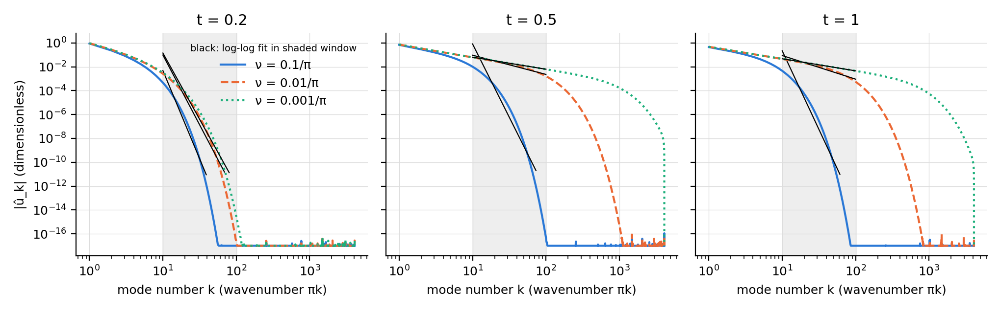
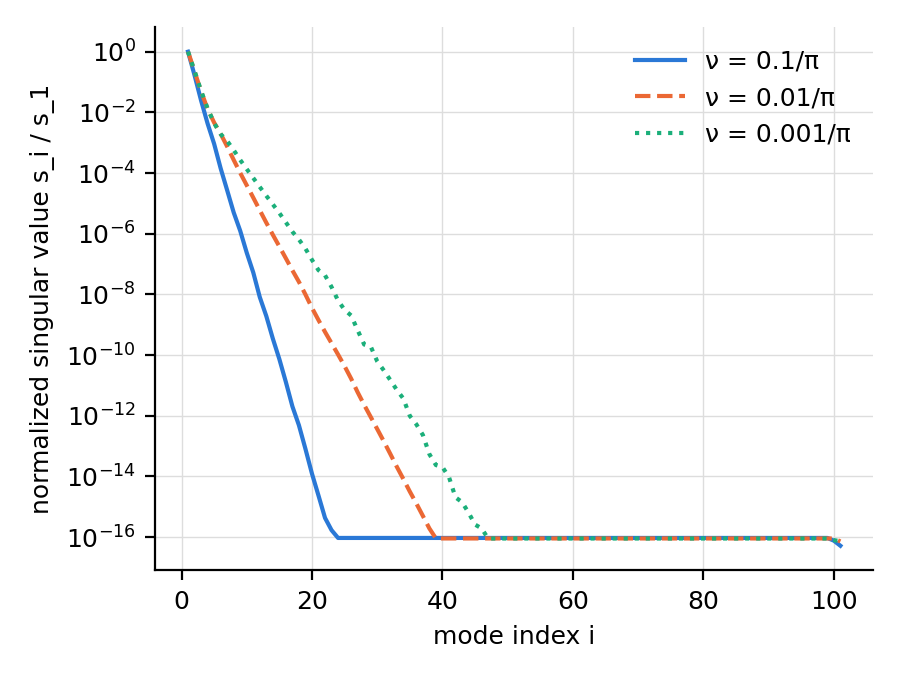
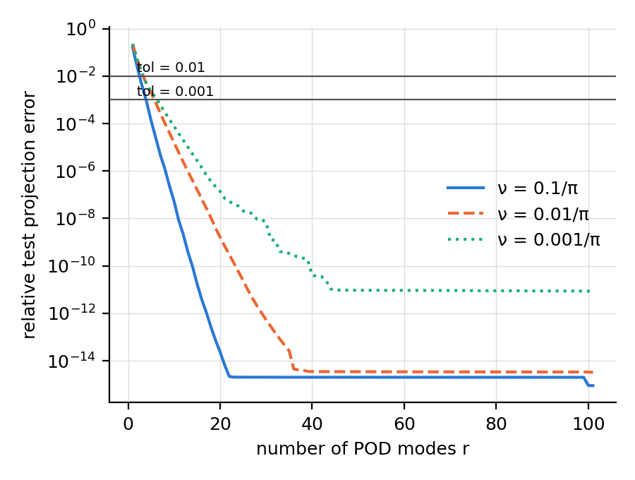

# Burgers structure study

> **Note:** This repo replaces an earlier version of this project (pinns-burgers-benchmarks), whose repository is now private.
> Some of the code was moved from the earlier version. However, tests and results here were written and generated from scratch in this repo.


## Why this project

My broader question is how the structure of a physical model shapes a learning method. One
argument for why it should matter: neural networks tend to fit smooth, low-frequency structure first
and sharp detail last (spectral bias), so a PDE whose solution develops a shock should be hard
for a standard network. That argument rests on a premise that can be tested without any network:

> **Does a sharper shock make the solution harder to represent?**

This repository tests that premise on Burgers' equation $u_t + u\,u_x = \nu\,u_{xx}$ with
$u(x,0) = -\sin(\pi x)$, at three viscosities $\nu \in \{0.1/\pi,\ 0.01/\pi,\ 0.001/\pi\}$.
Lower $\nu$ means a sharper shock. "Harder to represent" is measured two ways: how much
high-frequency content the solution has (Fourier spectrum), and how many fixed patterns a linear
basis needs to rebuild the solution family (POD). The predictions were written and tagged before
any analysis was run (see [docs/PREDICTIONS.md](docs/PREDICTIONS.md)).

## Summary of results

**Yes, the premise holds, with caveats.**

- **Fourier (P1, supported).** The spectrum flattens as $\nu$ decreases. At $\nu = 0.001/\pi$ the
  fitted log-log slope is about $-1$, the signature of a jump. At $\nu = 0.01/\pi$ it is about $-2$
  at $T = 1$, and at $\nu = 0.1/\pi$ it is far steeper, since the solution is smooth.
- **POD singular values (P2, marked contradicted).** Singular values decay more slowly at lower
  $\nu$, as predicted, but the curves cross by a small margin at one rank, which fails the strict check.
- **Modes needed (P3, marked contradicted).** At tolerance $10^{-3}$ the mode count rises strictly
  with sharper shocks (4, 6, 7). At $10^{-2}$ two cases tie (3, 4, 4), and ties count as failing.

Two of the three predictions hold as trends and fail my strict criteria at a few points. The
mode counts are small, so exact rankings are fragile. Details are in the tables below.

**What this does not show.** Nothing here tests a neural network. It supports the premise
behind the spectral-bias argument; it does not show that a PINN fails on shocks or that a
structure-aware architecture helps.

## Where this leads

Phase 2 (planned, not yet implemented) compares a standard PINN with a variant whose
architecture is chosen from the PDE's structure, and checks where in the spectrum each one
fails. The question this repository answers first is whether the premise is true at all.

## What these results suggest for the architecture

This repository is the first case in a larger effort: deriving architecture choices for a neural PDE
solver from an analysis of the PDE, before any training. The measurements above are the analysis.
The rules below are **hypotheses they motivate, not results**; Phase 2 is designed to test them.

| Design choice | What the Burgers analysis says | Proposed rule (hypothesis) |
|---|---|---|
| **Input encoding** | The spectrum stays near $1/k$ out to roughly $k \sim 1/\nu$, and a network with spectral bias learns that content last. | Frequencies in the encoding should reach about $1/\nu$, spaced across scales, so the encoding range is set from the PDE instead of tuned by trial and error. |
| **Coordinates** | The shock layer is about $\nu$ wide, so the sharp feature lives on a length scale that shrinks with $\nu$. | Also feed the network a stretched coordinate $\xi = x/\nu$, so the front has width of order one in the variable the network sees. |
| **Activation** | The residual loss needs $u_{xx}$, and ReLU's second derivative is zero. The stationary viscous shock profile is exactly $-a\tanh\!\big(ax/(2\nu)\big)$. | Use a smooth, saturating activation such as $\tanh$, which can represent the front's shape directly, with some first-layer weights initialized at scale $\sim 1/\nu$. |
| **Spatial vs. spectral representation** | A single front is dense in frequency ($1/k$) but sparse in space, and POD needs more global modes as $\nu$ drops. | Prefer a few localized steep units for the front over many global Fourier components. |
| **Latent dimension** (operator-style models) | POD needs 4, 6, 7 modes at tolerance $10^{-3}$ as $\nu$ decreases. | Size the bottleneck from the POD mode count for the target tolerance, and let it grow as $\nu$ drops. |
| **Hard constraints** | The solution stays odd about $x = 0$ and vanishes at $x = \pm 1$. | Build $u(-x,t) = -u(x,t)$ and the boundary conditions into the architecture instead of penalizing them in the loss. |
| **Width and depth** | Not determined. One front needs only a few steep units, and the analysis does not say how wide or deep the smooth part must be. | No rule proposed. Treat these as ablations in Phase 2, not as claims. |
| **Training around it** | The difficult content is concentrated near the shock and gets harder as $\nu$ drops. | Start at larger $\nu$ and decrease it step by step, and place residual points densely near the shock. |

**How this will be tested.** Phase 2 trains a baseline PINN and one variant that changes a single
row above (the input encoding, sized from the measured spectrum), then compares where in the
spectrum each one's error sits. The control is the smooth case $\nu = 0.1/\pi$, where the baseline
is expected to do fine. If the variant doesn't help at the wavenumbers where the baseline fails,
that rule is wrong.

## 2. Hypothesis and predictions

Predictions P1 to P3 are in [docs/PREDICTIONS.md](docs/PREDICTIONS.md). That file was committed and tagged
`predictions` before any analysis was run (`git show predictions`). In short: as nu decreases, (P1) Fourier
coefficients decay more slowly, (P2) POD singular values decay more slowly, and (P3) more POD modes are needed
for a fixed test error. Background is in [docs/THEORY.md](docs/THEORY.md); judgment calls are in [docs/DECISIONS.md](docs/DECISIONS.md).

## 3. Setup

Generated from `configs/default.yaml` by `make report`.

<!-- SETUP:START -->
| Item | Value |
|---|---|
| Equation | u_t + u u_x = nu u_xx |
| Domain | x in [-1, 1], t in [0, 1] |
| Initial / boundary | u(x,0) = -sin(pi x), u(-1,t) = u(1,t) = 0 |
| Viscosities | 0.1/pi, 0.01/pi, 0.001/pi |
| Grid | nx = 8193 (dx = 0.000244), nt = 201 (dt = 0.005) |
| Train / test split | interleaved: even-index times train, odd-index times test |
| POD tolerances | 0.01, 0.001 |
| Spectrum times | 0.2, 0.5, 1 (fit window k in [10, 100]) |
<!-- SETUP:END -->

## 4. How to run

```
make install      # pip install -e .
make test
make data
make spectrum
make pod
make report       # builds README results section from summary.json
make all          # data + spectrum + pod + report
```

On Windows without `make`, use `mingw32-make` (GNU make) with the same targets.

## 5. Results

Everything between the markers below is generated by `make report` from `results/<run_id>/summary.json`;
none of it is typed by hand.

<!-- RESULTS:START -->
Run `20261031-134406-75c77a1` (git `75c77a1`); reference data computed in 115 s, whole pipeline in 122 s.

**Shock resolution at t = t_max** (grid points across the steepest front):

| nu | points across shock | required | ok |
|---|---|---|---|
| 0.1/pi | 646.3 | 5 | yes |
| 0.01/pi | 69.6 | 5 | yes |
| 0.001/pi | 7.2 | 5 | yes |

**Fourier decay.** Fitted log-log slope of |u_hat_k| over k in [10, 100] (amplitudes below 1e-12 x max excluded). These are estimates over a finite window, not decay laws.

| nu | t | slope | R^2 | points used | k range used |
|---|---|---|---|---|---|
| 0.1/pi | 0.2 | -14.77 | 0.969 | 30 | 10-39 |
| 0.1/pi | 0.5 | -12.29 | 0.941 | 64 | 10-73 |
| 0.1/pi | 1 | -13.17 | 0.949 | 52 | 10-61 |
| 0.01/pi | 0.2 | -11.69 | 0.951 | 60 | 10-69 |
| 0.01/pi | 0.5 | -1.61 | 0.971 | 91 | 10-100 |
| 0.01/pi | 1 | -1.98 | 0.955 | 91 | 10-100 |
| 0.001/pi | 0.2 | -11.10 | 0.950 | 71 | 10-80 |
| 0.001/pi | 0.5 | -1.01 | 1.000 | 91 | 10-100 |
| 0.001/pi | 1 | -1.01 | 1.000 | 91 | 10-100 |



**POD.** Basis from 101 training snapshots, error measured on 100 test snapshots (interleaved split).

| nu | modes for tol 0.01 | modes for tol 0.001 | missing energy, 5 modes | missing energy, 10 modes | missing energy, 20 modes |
|---|---|---|---|---|---|
| 0.1/pi | 3 | 4 | 2.06e-08 | 2.76e-15 | 6.10e-30 |
| 0.01/pi | 4 | 6 | 4.29e-06 | 2.66e-10 | 2.29e-18 |
| 0.001/pi | 4 | 7 | 5.13e-06 | 6.01e-09 | 5.77e-15 |




**Observed vs predicted** (predictions in [docs/PREDICTIONS.md](docs/PREDICTIONS.md), written before these results):

| Prediction | Verdict | Evidence |
|---|---|---|
| P1 Fourier decay slower for smaller nu | **supported** | slopes at t = 1 from largest to smallest nu: -13.17, -1.98, -1.01 |
| P2 singular values decay slower for smaller nu | **contradicted** | At rank 5, s_r/s_1 is 9.18e-4, 4.60e-3, 4.43e-3 (largest to smallest nu), so not strictly increasing. s_r/s_1 at ranks 10, 20 does increase. Missing energy at ranks 5, 10, 20 does increase. |
| P3 more modes needed for smaller nu | **contradicted** | modes needed from largest to smallest nu: tol 0.01: 3, 4, 4; tol 0.001: 4, 6, 7 |
<!-- RESULTS:END -->

### Reading the verdicts

P1 held clearly. P2 and P3 held in trend but not under the strict rules fixed beforehand. P2 fails only
because at rank 5 the two smaller viscosities are nearly equal in s_5/s_1 (4.60e-3 vs 4.43e-3), while
missing energy and the higher-rank values do increase as nu decreases. P3 fails at tol 0.01 because two
viscosities tie at 4 modes, while at tol 0.001 the count increases (4, 6, 7). The rules were not changed
after seeing the data.

## 6. What this does NOT show

- Nothing here is about neural networks. Phase 1 measures properties of the *exact solution* (Fourier decay)
  and of a *linear reduced basis* (POD). It says nothing about spectral bias, PINN accuracy or training difficulty.
- The log-log slopes are fits over one fixed wavenumber window. They are estimates of local decay, not
  asymptotic decay laws, and change if the window changes.
- Where the spectrum decays exponentially (large nu, early times), a power-law slope such as -13 is only a
  rough summary; only the trend across nu and t should be read, not the value.
- One equation, one initial condition, three viscosities, one train/test split. No claim of generality beyond that.
- POD is tested on interpolation in time (test snapshots between training snapshots), not on new viscosities or extrapolation.

## 7. Status

| Item | Status |
|---|---|
| Phase 1: reference solutions, Fourier and POD analysis, tests, README | Done |
| Phase 2: PINN baseline vs structure-aware variant (`src/burgers/pinn/`, interfaces only) | Not started |
| Phase 3: own SVD, DMD, quadratic manifolds, neural operators | Not started (out of scope) |

## 8. Next steps

- Phase 2: train a tanh MLP PINN and a Fourier-feature variant with the same parameter and iteration budget
  over several seeds, and compare relative L2 error, error near the shock and the error's Fourier spectrum
  against the reference data produced here.

## 9. Repo layout

```
configs/            default.yaml (Phase 1), pinn_*.yaml (Phase 2 stubs)
src/burgers/        config, reference (Hopf-Cole), data, spectrum, pod, metrics, plotting, io, cli
src/burgers/pinn/   Phase 2 interfaces (raise NotImplementedError)
tests/              pytest suite (reference validation, spectrum, POD, metrics, CLI smoke test)
docs/               PREDICTIONS.md, THEORY.md, DECISIONS.md
results/<run_id>/   figures, table_modes_needed.md, summary.json, config copy (large .npz files ignored)
```

## 10. References

- E. Hopf (1950), "The partial differential equation u_t + u u_x = mu u_xx", Comm. Pure Appl. Math. 3, 201-230. (to verify)
- J. D. Cole (1951), "On a quasi-linear parabolic equation occurring in aerodynamics", Quart. Appl. Math. 9, 225-236. (to verify)
- C. Basdevant et al. (1986), "Spectral and finite difference solutions of the Burgers equation", Computers & Fluids 14, 23-41. (to verify)
- M. Raissi, P. Perdikaris, G. E. Karniadakis (2019), "Physics-informed neural networks", J. Comput. Phys. 378, 686-707. (to verify)
- C. Eckart, G. Young (1936), "The approximation of one matrix by another of lower rank", Psychometrika 1, 211-218. (to verify)
- M. Ohlberger, S. Rave (2016), "Reduced basis methods: success, limitations and future challenges", Proc. ALGORITMY. (to verify)
