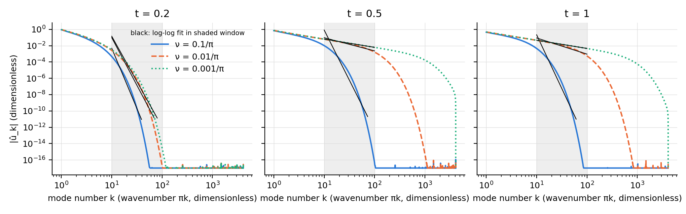
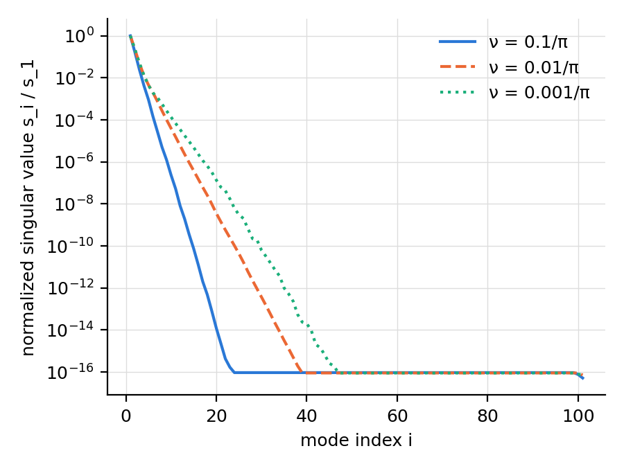
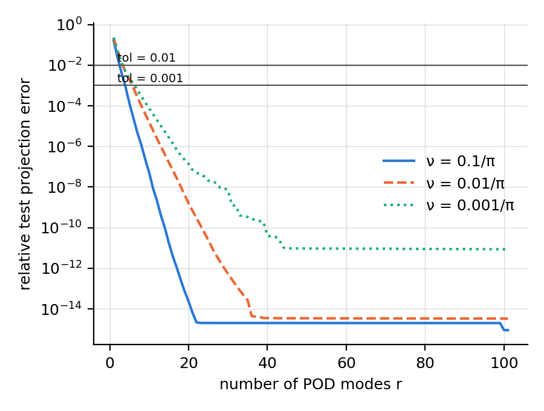

| Item | Value |
|---|---|
| Equation | u_t + u u_x = nu u_xx |
| Domain | x in [-1, 1], t in [0, 1] |
| Initial / boundary | u(x,0) = -sin(pi x), u(-1,t) = u(1,t) = 0 |
| Viscosities | 0.1/pi, 0.01/pi, 0.001/pi |
| Grid | nx = 8193 (dx = 0.000244), nt = 201 (dt = 0.005) |
| Train / test split | interleaved: even-index times train, odd-index times test |
| POD tolerances | 0.01, 0.001 |
| Spectrum times | 0.2, 0.5, 1 (fit window k in [10, 100]) |

Run `20261031-133809-23bf1b1` (git `23bf1b1`); reference data computed in 116 s, whole pipeline in 123 s.

**Shock resolution at t = t_max** (grid points across the steepest front):

| nu | points across shock | required | ok |
|---|---|---|---|
| 0.1/pi | 646.3 | 5 | yes |
| 0.01/pi | 69.6 | 5 | yes |
| 0.001/pi | 7.2 | 5 | yes |

**Fourier decay.** Fitted log-log slope of |u_hat_k| over k in [10, 100] (amplitudes below 1e-12 x max excluded). These are estimates over a finite window, not decay laws.

| nu | t | slope | R^2 | points used | k range used |
|---|---|---|---|---|---|
| 0.1/pi | 0.2 | -14.77 | 0.969 | 30 | 10-39 |
| 0.1/pi | 0.5 | -12.29 | 0.941 | 64 | 10-73 |
| 0.1/pi | 1 | -13.17 | 0.949 | 52 | 10-61 |
| 0.01/pi | 0.2 | -11.69 | 0.951 | 60 | 10-69 |
| 0.01/pi | 0.5 | -1.61 | 0.971 | 91 | 10-100 |
| 0.01/pi | 1 | -1.98 | 0.955 | 91 | 10-100 |
| 0.001/pi | 0.2 | -11.10 | 0.950 | 71 | 10-80 |
| 0.001/pi | 0.5 | -1.01 | 1.000 | 91 | 10-100 |
| 0.001/pi | 1 | -1.01 | 1.000 | 91 | 10-100 |

**POD.** Basis from 101 training snapshots, error measured on 100 test snapshots (interleaved split).

| nu | modes for tol 0.01 | modes for tol 0.001 | energy in 5 modes | energy in 10 modes | energy in 20 modes |
|---|---|---|---|---|---|
| 0.1/pi | 3 | 4 | 1.000000 | 1.000000 | 1.000000 |
| 0.01/pi | 4 | 6 | 0.999996 | 1.000000 | 1.000000 |
| 0.001/pi | 4 | 7 | 0.999995 | 1.000000 | 1.000000 |

**Observed vs predicted** (predictions in [docs/PREDICTIONS.md](docs/PREDICTIONS.md), written before these results):

| Prediction | Verdict | Evidence |
|---|---|---|
| P1 Fourier decay slower for smaller nu | **supported** | slopes at t = 1 from largest to smallest nu: -13.17, -1.98, -1.01 |
| P2 singular values decay slower for smaller nu | **contradicted** | energy captured at ranks 5, 10, 20: 0.1/pi 1.000000/1.000000/1.000000; 0.01/pi 0.999996/1.000000/1.000000; 0.001/pi 0.999995/1.000000/1.000000 |
| P3 more modes needed for smaller nu | **contradicted** | modes needed from largest to smallest nu: tol 0.01: 3, 4, 4; tol 0.001: 4, 6, 7 |
